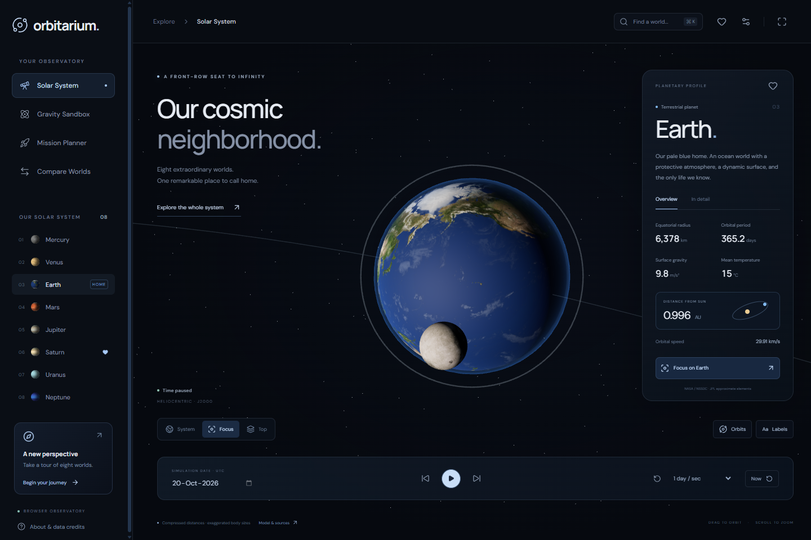

# Orbitarium

**The Universe Is Yours to Explore.**

A browser-based observatory with interactive 3D planets and real, inspectable physics. No account, paid API, database, or production server is required.

**[Open Orbitarium](https://orbitarium.arnavrival12.workers.dev)** · [GitHub](https://github.com/Arnav-Dugad/orbitarium)



## First light release

- Explore all eight planets with local 2K surface maps, Saturn's rings, an illustrative Earth atmosphere, and a schematic Moon.
- Select a planet, orbit the camera, switch between focused, top, and whole-system views, or take an eight-world tour.
- Advance or reverse time, jump to dates in 1800–2050, and select compressed or proportional orbital distances.
- Inspect NASA physical parameters and calculated heliocentric distance and speed.
- Run a Web Worker N-body sandbox with a velocity-Verlet solver, trajectories, velocity vectors, mass/position/velocity editing, body duplication, and simplified merging collisions.
- Experiment with Sun–Earth, binary-star, figure-eight, and collision presets. Save locally or import/export validated JSON.
- Calculate circular, coplanar heliocentric Hohmann transfers and ideal rocket-equation propellant estimates.
- Compare planetary radius, mass, gravity, escape speed, periods, and temperature.
- Search with Ctrl/Command K, keep local favorites, adjust quality, and reduce camera/interface motion.

This is an initial, functional release of the broader brief. Satellite propagation, black holes, rocket flight, exoplanets, eclipses, and other advanced labs remain planned. See [the feature matrix and backlog](docs/ROADMAP.md).

## Run locally

Node.js 24 LTS and npm are recommended.

```sh
npm ci
npm run dev
```

Open the printed localhost URL. The application is React + TypeScript + Three.js, built with Vite. Physics is independent of React; the gravity integrator runs in a dedicated Web Worker. All images and fonts are bundled locally.

```sh
npm run lint       # ESLint, TypeScript and hook rules
npm test           # scientific reference and conservation checks
npm run build      # TypeScript check and production bundle
npm run test:e2e   # Playwright interaction and responsive checks
```

Playwright uses installed Chrome on Windows. On Linux install its browser once with `npx playwright install --with-deps chromium`. To test a deployment, set `TEST_BASE_URL` to its origin before running the browser suite. CI runs lint, physics tests, build, and browser tests on every push and pull request.

## Scientific accuracy

Every view explains its fidelity and assumptions. This is an educational application, not navigation or professional mission-design software.

**Solar System:** JPL Table 1 Keplerian elements and rates in the J2000 mean ecliptic frame, restricted to 1800–2050. UTC approximates the time argument. Earth uses the Earth–Moon barycenter. Distances are either radially compressed or proportional at 10 scene units/AU. Planet sizes are exaggerated in both modes. Map orientation and prime meridians are illustrative. The Moon's orbit is schematic. Constant render-light intensity preserves visibility across compressed distances; it is not a solar flux model. Close-up mode hides other planets to prevent foreground obstruction.

**Gravity:** Newtonian gravity in AU, solar masses, and Julian years, with G = 4π² and fixed-step velocity Verlet. No softening or relativistic corrections. Display radii have a minimum pixel size. Collisions merge volume, mass, and momentum; they dissipate kinetic energy. Energy drift is meaningful for non-colliding, unedited systems. Close encounters can require smaller steps. Local saves store the current body state; trails, elapsed time, and diagnostics restart on loading.

**Missions:** two instantaneous heliocentric burns between circular, coplanar planetary orbits. Excludes launch, sphere-of-influence transitions, planetary capture, perturbations, actual departure windows, and low-thrust dynamics. Isp is treated as an ideal impulse parameter even at high values; a Hohmann maneuver assumes impulsive burns. Phase angle is the required ideal initial geometry, not a current launch opportunity. The transfer graphic compresses distances; its marker follows time through the physical transfer's eccentric anomaly.

## Sources and licenses

- [NASA/JPL orbital elements](https://ssd.jpl.nasa.gov/planets/approx_pos.html)
- [NASA/NSSDC physical parameters](https://nssdc.gsfc.nasa.gov/planetary/factsheet/)
- [Solar System Scope maps](https://www.solarsystemscope.com/textures/) — CC BY 4.0, based on NASA imagery; some colors and terrain were reconstructed by their creators.

Application code: [MIT](LICENSE). Images and fonts retain their own licenses. Full attribution: [THIRD_PARTY_NOTICES.md](THIRD_PARTY_NOTICES.md). No NASA endorsement is implied.

## Deploy to Cloudflare

This project uses [Cloudflare Workers Static Assets](https://developers.cloudflare.com/workers/static-assets/), with SPA routing configured in `wrangler.jsonc`.

```sh
npx wrangler login
npm run deploy
```

Use an unused Worker name or your existing Orbitarium Worker. The deployment command builds before uploading. No bindings or secrets are required by the application. Authentication remains in the Cloudflare CLI's account store and must never be committed. Cloudflare Pages is also possible with build command `npm run build`, output `dist`; the `_headers` file carries caching and response headers.

For automatic production updates, connect this GitHub repository in Cloudflare Workers Builds with build command `npm run build` and deploy command `npx wrangler deploy`. The initial CLI deployment does not automatically create that Git integration.

Vercel can serve the same Vite output: import the repository, choose Vite, build `npm run build`, output `dist`. The application uses hash navigation and needs no server-side route rewrites.

## Project structure

```text
src/components/   Accessible dialog, metric, range, and toggle controls
src/data/         Typed, attributed planetary reference data
src/scenes/       Three.js scene and camera lifecycle
src/simulation/   Independent Kepler, transfer, and N-body engines
src/workers/      Gravity computation and diagnostics
src/pages/        Gravity, mission, and comparison experiences
src/tests/        Physics and import validation tests
e2e/             Browser interactions and responsive checks
docs/            Screenshots, verification notes, feature status, roadmap
```
